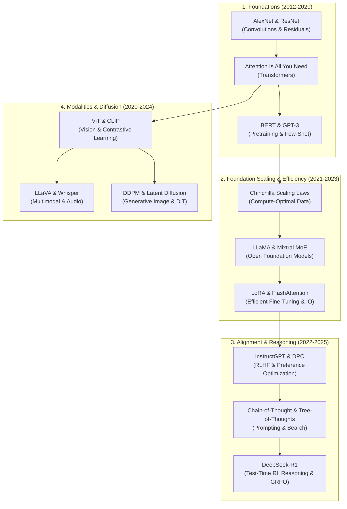

<div align="center">

# 🧠 AI/ML Research Papers Hub
### *A Curated, Deep-Dive Repository of Seminal & Frontier Machine Learning Research*

<p align="center">
  
  
  
  
  
</p>

<p align="center">
  <b>Comprehensive technical breakdowns, mathematical formulations, architectural schematics, open-source code links, and automated arXiv PDF downloads.</b>
</p>

</div>

---

## 📌 Repository Overview

This repository is an engineered knowledge base and research companion tracking the landmark breakthroughs that shaped modern Artificial Intelligence—from foundational convolutional networks to modern reasoning models and multimodal architectures.

Every paper in this repository includes:
- 📑 **Comprehensive Technical Dossier**: Problem framing, core architectural breakthroughs, mathematical derivations, and industry impact.
- 📐 **Rigorous Formulations**: KaTeX-rendered loss functions, attention equations, normalization layers, and optimization objectives.
- 🔗 **Direct Links**: ArXiv preprints, official conference PDFs, and reference GitHub code repositories.
- ⚡ **CLI Automation Tool**: Built-in Python tool (`scripts/paper_manager.py`) to search arXiv live, download PDFs, and generate BibTeX bibliographies.

---

## 🧭 Curated Research Tracks

```
ai-ml-research-papers/
├── 📁 01-foundational-architectures/      # AlexNet, ResNet, Transformer, BERT, GPT-3, ViT
├── 📁 02-large-language-models/           # Chinchilla, LLaMA 1/3, Mixtral MoE, DeepSeek-V3, Gemma
├── 📁 03-reasoning-and-alignment/         # InstructGPT (RLHF), DPO, CoT, Tree of Thoughts, DeepSeek-R1
├── 📁 04-generative-and-diffusion/        # GAN, VAE, DDPM, Latent Diffusion, DiT, Flow Matching
├── 📁 05-efficient-ml-and-architectures/  # LoRA, FlashAttention, RoPE, Mamba (SSM), QLoRA, Sparse MoE
├── 📁 06-multimodal-and-vision-language/  # CLIP, LLaVA, Flamingo, Whisper
├── 📁 07-reinforcement-learning/          # DQN, PPO, AlphaZero, Decision Transformer
├── 📁 papers_pdf/                         # Downloaded research paper PDFs
├── 📁 scripts/                            # arXiv Search, Downloader & BibTeX Generator CLI
└── 📄 citations.bib                       # Master BibTeX citations for all papers
```

---

## 🗺️ Recommended Reading Roadmap

For students, researchers, and engineers seeking a structured curriculum through modern AI:



---

## 📚 Master Index of Research Papers

| # | Year | Title | Primary Category | Venue | Key Innovation | Links |
|---|---|---|---|---|---|---|
| **01** | 2012 | **AlexNet** | Foundational Architectures | NeurIPS 2012 | GPU Convolutions, ReLU, Dropout | [Dossier](01-foundational-architectures/01_alexnet_2012.md) • [arXiv](https://arxiv.org/abs/1206.5538) |
| **02** | 2015 | **ResNet** | Foundational Architectures | CVPR 2016 | Identity Residual Shortcut Mappings | [Dossier](01-foundational-architectures/02_resnet_2015.md) • [arXiv](https://arxiv.org/abs/1512.03385) |
| **03** | 2017 | **Transformer** | Foundational Architectures | NeurIPS 2017 | Multi-Head Self-Attention ($O(1)$ Path) | [Dossier](01-foundational-architectures/03_attention_is_all_you_need_2017.md) • [arXiv](https://arxiv.org/abs/1706.03762) |
| **04** | 2018 | **BERT** | Foundational Architectures | NAACL 2019 | Bidirectional Masked LM & NSP | [Dossier](01-foundational-architectures/04_bert_2018.md) • [arXiv](https://arxiv.org/abs/1810.04805) |
| **05** | 2020 | **GPT-3** | Foundational Architectures | NeurIPS 2020 | 175B Autoregressive Few-Shot Learning | [Dossier](01-foundational-architectures/05_gpt3_2020.md) • [arXiv](https://arxiv.org/abs/2005.14165) |
| **06** | 2020 | **Vision Transformer (ViT)** | Foundational Architectures | ICLR 2021 | 16x16 Patch Embeddings for Vision | [Dossier](01-foundational-architectures/06_vision_transformer_vit_2020.md) • [arXiv](https://arxiv.org/abs/2010.11929) |
| **07** | 2022 | **Chinchilla** | Large Language Models | NeurIPS 2022 | Equal Parameter/Token Compute Scaling | [Dossier](02-large-language-models/01_chinchilla_scaling_laws_2022.md) • [arXiv](https://arxiv.org/abs/2203.15556) |
| **08** | 2023 | **LLaMA** | Large Language Models | arXiv 2023 | Open 7B-65B Foundation Model Recipe | [Dossier](02-large-language-models/02_llama_2023.md) • [arXiv](https://arxiv.org/abs/2302.13971) |
| **09** | 2024 | **Llama 3 Herd** | Large Language Models | arXiv 2024 | 405B Frontier Open Model, 15T Tokens | [Dossier](02-large-language-models/03_llama_3_herd_2024.md) • [arXiv](https://arxiv.org/abs/2407.21783) |
| **10** | 2024 | **Mixtral 8x7B** | Large Language Models | arXiv 2024 | Sparse Top-2 Router Mixture-of-Experts | [Dossier](02-large-language-models/04_mixtral_of_experts_2024.md) • [arXiv](https://arxiv.org/abs/2401.04088) |
| **11** | 2024 | **DeepSeek-V3** | Large Language Models | arXiv 2024 | Multi-Head Latent Attention (MLA) & FP8 | [Dossier](02-large-language-models/05_deepseek_v3_2024.md) • [arXiv](https://arxiv.org/abs/2412.19437) |
| **12** | 2024 | **Gemma** | Large Language Models | arXiv 2024 | Efficient Open Weights via Gemini Lineage | [Dossier](02-large-language-models/06_gemma_models_2024.md) • [arXiv](https://arxiv.org/abs/2403.08295) |
| **13** | 2022 | **InstructGPT** | Reasoning & Alignment | NeurIPS 2022 | 3-Stage RLHF Pipeline with PPO | [Dossier](03-reasoning-and-alignment/01_instructgpt_rlhf_2022.md) • [arXiv](https://arxiv.org/abs/2203.02155) |
| **14** | 2023 | **DPO** | Reasoning & Alignment | NeurIPS 2023 | Closed-form Policy Preference Optimization | [Dossier](03-reasoning-and-alignment/02_direct_preference_optimization_2023.md) • [arXiv](https://arxiv.org/abs/2305.18290) |
| **15** | 2022 | **Chain-of-Thought (CoT)** | Reasoning & Alignment | NeurIPS 2022 | Step-by-Step Rationale Prompting | [Dossier](03-reasoning-and-alignment/03_chain_of_thought_2022.md) • [arXiv](https://arxiv.org/abs/2201.11903) |
| **16** | 2023 | **Tree of Thoughts (ToT)** | Reasoning & Alignment | NeurIPS 2023 | Tree Search (BFS/DFS) with Lookahead | [Dossier](03-reasoning-and-alignment/04_tree_of_thoughts_2023.md) • [arXiv](https://arxiv.org/abs/2305.10601) |
| **17** | 2025 | **DeepSeek-R1** | Reasoning & Alignment | arXiv 2025 | Pure Large-Scale RL Reasoning & GRPO | [Dossier](03-reasoning-and-alignment/05_deepseek_r1_2025.md) • [arXiv](https://arxiv.org/abs/2501.12948) |
| **18** | 2022 | **Constitutional AI** | Reasoning & Alignment | arXiv 2022 | Self-Supervised Critique & RLAIF | [Dossier](03-reasoning-and-alignment/06_constitutional_ai_2022.md) • [arXiv](https://arxiv.org/abs/2212.08073) |
| **19** | 2014 | **GAN** | Generative Models | NeurIPS 2014 | Minimax Game ($G$ vs $D$) | [Dossier](04-generative-and-diffusion/01_generative_adversarial_nets_2014.md) • [arXiv](https://arxiv.org/abs/1406.2661) |
| **20** | 2013 | **VAE** | Generative Models | ICLR 2014 | Reparameterization Trick & ELBO | [Dossier](04-generative-and-diffusion/02_variational_autoencoders_vae_2013.md) • [arXiv](https://arxiv.org/abs/1312.6114) |
| **21** | 2020 | **DDPM** | Generative Models | NeurIPS 2020 | Markov Reverse Diffusion & Score Matching | [Dossier](04-generative-and-diffusion/03_denoising_diffusion_ddpm_2020.md) • [arXiv](https://arxiv.org/abs/2006.11239) |
| **22** | 2021 | **Stable Diffusion** | Generative Models | CVPR 2022 | Latent Autoencoder Diffusion & Cross-Attn | [Dossier](04-generative-and-diffusion/04_latent_diffusion_models_2021.md) • [arXiv](https://arxiv.org/abs/2112.10752) |
| **23** | 2022 | **DiT** | Generative Models | ICCV 2023 | Transformer Backbone for Diffusion | [Dossier](04-generative-and-diffusion/05_diffusion_transformer_dit_2022.md) • [arXiv](https://arxiv.org/abs/2212.09748) |
| **24** | 2022 | **Flow Matching** | Generative Models | ICLR 2023 | Simulation-Free Optimal Transport Flows | [Dossier](04-generative-and-diffusion/06_flow_matching_2022.md) • [arXiv](https://arxiv.org/abs/2210.02747) |
| **25** | 2021 | **LoRA** | Efficient ML & Architectures | ICLR 2022 | Low-Rank Parameter Adapter Update ($B \cdot A$) | [Dossier](05-efficient-ml-and-architectures/01_lora_low_rank_adaptation_2021.md) • [arXiv](https://arxiv.org/abs/2106.09685) |
| **26** | 2022 | **FlashAttention** | Efficient ML & Architectures | NeurIPS 2022 | IO-Aware Tiling & Online Softmax | [Dossier](05-efficient-ml-and-architectures/02_flash_attention_2022.md) • [arXiv](https://arxiv.org/abs/2205.14135) |
| **27** | 2021 | **RoPE** | Efficient ML & Architectures | Neurocomputing 2024 | 2D Orthogonal Rotary Matrix Embedding | [Dossier](05-efficient-ml-and-architectures/03_rope_rotary_position_embedding_2021.md) • [arXiv](https://arxiv.org/abs/2104.09864) |
| **28** | 2023 | **Mamba (SSM)** | Efficient ML & Architectures | arXiv 2023 | Selective Linear-Time State Space Model | [Dossier](05-efficient-ml-and-architectures/04_mamba_selective_state_spaces_2023.md) • [arXiv](https://arxiv.org/abs/2312.00752) |
| **29** | 2023 | **QLoRA** | Efficient ML & Architectures | NeurIPS 2023 | 4-bit NormalFloat & Double Quantization | [Dossier](05-efficient-ml-and-architectures/05_qlora_quantized_finetuning_2023.md) • [arXiv](https://arxiv.org/abs/2305.14314) |
| **30** | 2017 | **Sparsely-Gated MoE** | Efficient ML & Architectures | ICLR 2017 | Noisy Top-K Conditional Computation | [Dossier](05-efficient-ml-and-architectures/06_sparse_mixture_of_experts_moe_2017.md) • [arXiv](https://arxiv.org/abs/1701.06538) |
| **31** | 2021 | **CLIP** | Multimodal & Vision-Lang | ICML 2021 | Contrastive Image-Text Pretraining | [Dossier](06-multimodal-and-vision-language/01_clip_contrastive_vision_language_2021.md) • [arXiv](https://arxiv.org/abs/2103.00020) |
| **32** | 2023 | **LLaVA** | Multimodal & Vision-Lang | NeurIPS 2023 | Visual Instruction Tuning with GPT-4 Data | [Dossier](06-multimodal-and-vision-language/02_llava_visual_instruction_tuning_2023.md) • [arXiv](https://arxiv.org/abs/2304.08485) |
| **33** | 2022 | **Flamingo** | Multimodal & Vision-Lang | NeurIPS 2022 | Interleaved Images/Text & Perceiver Resampler | [Dossier](06-multimodal-and-vision-language/03_flamingo_visual_language_model_2022.md) • [arXiv](https://arxiv.org/abs/2204.14198) |
| **34** | 2022 | **Whisper** | Multimodal & Vision-Lang | ICML 2023 | Multitask Weak Supervision on 680k Audio Hours | [Dossier](06-multimodal-and-vision-language/04_whisper_speech_recognition_2022.md) • [arXiv](https://arxiv.org/abs/2212.04356) |
| **35** | 2013 | **DQN** | Reinforcement Learning | Nature 2015 | Experience Replay & Deep Q-Learning | [Dossier](07-reinforcement-learning/01_deep_q_networks_dqn_2013.md) • [arXiv](https://arxiv.org/abs/1312.5602) |
| **36** | 2017 | **PPO** | Reinforcement Learning | arXiv 2017 | Clipped Surrogate Objective for Stable RL | [Dossier](07-reinforcement-learning/02_proximal_policy_optimization_ppo_2017.md) • [arXiv](https://arxiv.org/abs/1707.06347) |
| **37** | 2017 | **AlphaZero** | Reinforcement Learning | Science 2018 | Tabula Rasa Self-Play with MCTS Guidance | [Dossier](07-reinforcement-learning/03_alphazero_game_intelligence_2017.md) • [arXiv](https://arxiv.org/abs/1712.01815) |
| **38** | 2021 | **Decision Transformer** | Reinforcement Learning | NeurIPS 2021 | RL as Autoregressive Return-to-Go Modeling | [Dossier](07-reinforcement-learning/04_decision_transformer_2021.md) • [arXiv](https://arxiv.org/abs/2106.01345) |

---

## 🛠️ CLI Tooling: `paper_manager.py`

This repository includes a standalone Python CLI tool to manage papers, search arXiv live, and download PDFs.

### 1. List Cataloged Papers
```bash
python scripts/paper_manager.py list
```

### 2. Search arXiv Live for Any Research Paper
Query arXiv in real-time without installing third-party dependencies:
```bash
python scripts/paper_manager.py search --query "ti:mixture of experts" --max 5
```

### 3. Download a Paper PDF
Download any research paper PDF into `papers_pdf/` by arXiv ID:
```bash
python scripts/paper_manager.py download --id 1706.03762
```

### 4. Batch Download Curated Seminal Papers
Download top seminal papers with polite rate-limiting:
```bash
python scripts/paper_manager.py download-all --limit 10
```

### 5. Export Master BibTeX Citations
Regenerate or export `citations.bib` containing formatted citations for all papers:
```bash
python scripts/paper_manager.py export-bib
```

---

## 📖 Citation & Usage

To cite this repository in your research or academic work:

```bibtex
@misc{aiml_research_papers_hub,
  title = {AI/ML Research Papers Hub: Curated Seminal and Frontier Research Breakdowns},
  author = {Keshav K and Contributors},
  year = {2026},
  publisher = {GitHub},
  howpublished = {\\url{https://github.com/KESHAV100-tech/AI-ML-research-papers}}
}
```

---

<div align="center">
  <sub>Maintained with ❤️ for the global AI/ML research and engineering community.</sub>
</div>
